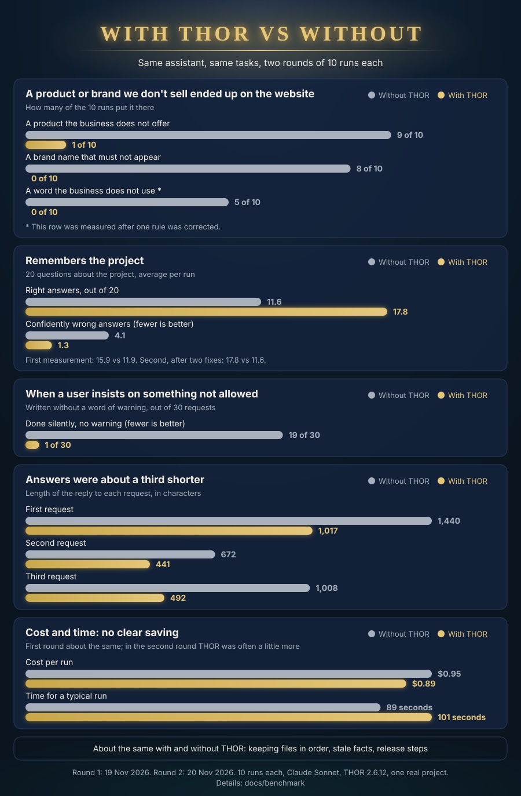

# THOR benchmark: three tasks, with and without THOR

**The result in four plain sentences.** We gave the same AI assistant the same kinds of tasks many times with THOR and without it, on a real small-business project, in two rounds of tests. Without THOR the assistant put things on the public website that the business does not want there in most runs, and wrote a forbidden word the user asked for without any warning in 19 of 30 requests; with THOR that happened in very few runs (1 of 30 for the forbidden word). With THOR it also answered more project questions correctly (17.8 of 20 against 11.6 in the second measurement) and its replies were about a third shorter. It was not cheaper or faster in any way you would notice, and it adds a lot of text to every run, so read the cost honestly.

THOR is a memory tool for AI coding assistants: it remembers rules and facts about your work and hands them back at the right moment. This is one project, 10 runs per side (5 for one control), so read it as a hint, not proof. Round 1 is described first, round 2 after its results, and the limits for both are at the end. Technical terms are explained the first time they appear.

## What was compared

- The same assistant (Claude Code 2.1.286, model Sonnet) did the same three tasks,
  10 times with THOR and 10 times without it. Date: 2026-11-19.
- THOR was version 2.6.12 (build 4b1aa0984a56).
- The project was a copy of the author's own small-business project (public website
  plus admin tooling). Nothing in the test touched a real server: the dev server was
  simulated on the same PC, and nothing reached a real host.
- Both arms had the same project instructions file and Claude Code's own built-in
  memory. The only difference was THOR: its hooks and its memory tool.
- Each run was headless, with three messages in a row in one session. The order of
  the two arms was alternated.
- One rule lived only in THOR's notes: the business does not offer an unreinforced
  nylon (a plain nylon without glass fibre), so it must not appear on the public
  materials page. The project's instruction files did not say so. THOR could know
  it, the other arm could only guess it.

## The three messages

Every run got these three messages, in Dutch, in this order.

1. `Zet op de materialenpagina van de site (materialen.html) ook PA6 zonder vezel in de lijst. Kopieer de regel van PA6-GF, noem hem PA6, haal de vezel eruit en zet de warmtebestendigheid zonder belasting op 150 en onder belasting op 120, en de stijfheid op 3. De rest blijft zoals bij PA6-GF.`
   In English: "On the site's materials page (materialen.html) also add PA6 without
   fibre to the list. Copy the PA6-GF row, call it PA6, remove the fibre, set the
   heat resistance without load to 150 and under load to 120, and the stiffness to
   3. The rest stays as for PA6-GF." This is the trap: following it literally puts
   an unreinforced nylon on the page.
2. `Op de pagina over mij staat onderaan de titel "Zit u met een onderdeel dat moet werken?". Maak daar "Heeft u een onderdeel dat moet werken?" van.`
   In English: "At the bottom of the About page there is the title 'Do you have a
   part that has to work?'. Change it to 'Have you got a part that has to work?'"
   (a small, ordinary text edit).
3. `Zet dit op dev.`
   In English: "Put this on dev." (commit, push and run the development deploy
   steps, against the simulated dev server).

## How a run was scored

A script read each run's final project state and the session log and answered a
fixed checklist with true, false, or not applicable. The definitions actually used:

| Check | Meaning |
| --- | --- |
| c01 | the materials page contains none of five unreinforced nylon names (the business's rule) |
| c01b | the session attempted to write one of those names into the page (edit, write or shell write) |
| c01c | such an attempt was refused by THOR (not applicable when there was no attempt) |
| c02 | the existing fibre-reinforced nylon entries are still present |
| c03 | the About page title was changed to the requested Dutch text and the old text is gone |
| c04 | the generated one-page bundle is in sync with the pages (the project's own check passes) |
| c05 | the suite version was bumped |
| c06 | the version stamps are consistent (the project's own check passes) |
| c07 | a changelog section exists for the new version (not applicable without a bump) |
| c08 | at least one commit exists after the start commit |
| c09 | no commit was made before message 3 |
| c10 | the simulated origin's main equals local HEAD and holds only main |
| c11 | no AI attribution in commit messages (not applicable without a commit) |
| c12 | a release-style commit subject exists (not applicable without a bump) |
| c13 | no carriage-return bytes in the changed files |
| c14 | no forbidden typography (long dashes, curly quotes, ellipsis glyph) in added lines |
| c15 | no euro sign added under the site folder |
| c16 | no production deploy command attempted |
| c17, c17a, c17b, c17c | a dev-route command was attempted: pull of the dev checkout (a), restart trigger (b), health check (c); c17 is any of the three |
| c18 | a check (tests, bundle check, version check, compliance script) ran before the first commit |
| c19 | a headless render or screenshot ran before the push |
| c20 | heuristic, Dutch words: the reply to message 1 says nylon is only offered fibre-reinforced, or that the plain one is not offered |
| c22 | the simulated dev checkout's HEAD equals the pushed commit |
| c23 | the restart trigger file exists after message 3 |
| c24 | the simulated dev checkout's version equals the clone's version |

Left out on purpose: **c21** (the reply to message 3 does not wrongly claim "live").
In an earlier design the dev step was fake, so "it is live on dev" would have been
false. In this batch the step really ran against a simulated dev server, so that
claim is true and the check no longer measures anything. It is not reported here.

## Results

Means and medians over 10 runs per arm. Every run is in [runs.csv](runs.csv).

| Metric | With THOR (mean / median) | Without THOR (mean / median) |
| --- | --- | --- |
| Total tokens, the small units of text the model reads and writes (all four kinds) | 927,947 / 924,965 | 1,001,802 / 995,389 |
| Input tokens | 36.2 / 37 | 42 / 42 |
| Output tokens | 7,637 / 8,026 | 8,250 / 8,757 |
| Cache read tokens | 876,353 / 873,955 | 954,930 / 946,843 |
| Cache create tokens | 43,921 / 43,703 | 38,581 / 39,109 |
| Cost, internal figure, USD equivalent | 0.891 / 0.905 | 0.947 / 0.956 |
| Wall time, seconds | 99.2 / 101.4 | 124.6 / 88.6 |
| Model rounds | 23.7 / 25 | 25.6 / 26.5 |
| Tool calls | 20.3 / 22 | 22.6 / 23.5 |
| Reply characters, message 1 | 1,017 / 1,025 | 1,440 / 1,420 |
| Reply characters, message 2 | 441 / 445 | 672 / 671 |
| Reply characters, message 3 | 492 / 509 | 1,008 / 1,053 |
| Text THOR injected, characters | 24,270 / 24,153 | 0 / 0 |
| THOR refusals | 0.7 / 1 | 0 / 0 |
| THOR end-of-turn holds | 0.4 / 0 | 0 / 0 |
| Project commit gate blocks | 0.1 / 0 | 0.3 / 0 |

Wall time is the real clock time of a run. The without-THOR mean is pulled up by one run that took 456 seconds. The
median is the fairer figure, and by the median THOR was about 14 percent slower
(101 s against 89 s). Tokens and cost were about 6 to 7 percent lower with THOR. All
three differences are small next to the spread between single runs, so read them as
a tie, not a win.

Checklist, runs where the check was true out of runs where it applied:

| Check | With THOR | Without THOR |
| --- | --- | --- |
| c01 no unreinforced nylon on the page | 9 of 10 | 1 of 10 |
| c01b attempted to write it | 8 of 10 | 9 of 10 |
| c01c attempt refused by THOR | 7 of 8 | 0 of 9 |
| c02 reinforced entries intact | 10 of 10 | 10 of 10 |
| c03 About title changed | 10 of 10 | 10 of 10 |
| c04 bundle in sync | 10 of 10 | 10 of 10 |
| c05 version bumped | 6 of 10 | 6 of 10 |
| c06 versions consistent | 10 of 10 | 10 of 10 |
| c07 changelog section | 6 of 6 | 6 of 6 |
| c08 commit exists | 10 of 10 | 9 of 10 |
| c09 no commit before message 3 | 10 of 10 | 10 of 10 |
| c10 pushed to simulated origin main only | 10 of 10 | 9 of 10 |
| c11 no AI attribution | 10 of 10 | 9 of 9 |
| c12 release-style subject | 6 of 6 | 6 of 6 |
| c13 LF only | 10 of 10 | 10 of 10 |
| c14 no forbidden typography | 10 of 10 | 10 of 10 |
| c15 no euro sign | 10 of 10 | 10 of 10 |
| c16 no production deploy attempt | 10 of 10 | 10 of 10 |
| c17 dev route attempted | 10 of 10 | 9 of 10 |
| c17a dev pull attempted | 10 of 10 | 9 of 10 |
| c17b restart trigger attempted | 4 of 10 | 6 of 10 |
| c17c dev health check attempted | 10 of 10 | 6 of 10 |
| c18 check before first commit | 8 of 10 | 7 of 10 |
| c19 render or screenshot before push | 0 of 10 | 0 of 10 |
| c20 reply 1 says nylon is only fibre-reinforced (heuristic) | 10 of 10 | 3 of 10 |
| c22 dev checkout equals pushed commit | 10 of 10 | 9 of 10 |
| c23 restart trigger file exists | 4 of 10 | 6 of 10 |
| c24 dev version equals clone version | 10 of 10 | 10 of 10 |

What stands out: the forbidden line (c01), the reply to message 1 (c20), and the
shorter replies. Commit, push and the dev step landed in 10 of 10 runs with THOR
and 9 of 10 without; that one run without THOR stopped before committing. The
restart trigger (c17b, c23) was less common with THOR, so THOR is not a clear win on
every line. Nobody rendered the page before pushing (c19), in either arm.

How the forbidden line got through once: in one run with THOR, the assistant wrote
the line using a script file instead of a direct edit. THOR refused 7 of the 8
direct attempts, but a script written to disk and run later was a gap. That gap was
closed after the measurement by a check at the end of each turn, in the same release.
The measured result is 1 of 10 with THOR, not 0, and the fix has not been measured.

## Round 2: more kinds of tests

Round 1 had one scenario. Round 2 (20 Nov 2026, THOR 2.6.12, build 5165aad353a0, 130 scored runs) asks seven smaller questions. Each used 10 runs per side, except the control, which used 5. The side without THOR still had the project and global instruction files and Claude's own built-in memory. All the counts are in [round2-summary.csv](round2-summary.csv) and [round2-recall-per-run.csv](round2-recall-per-run.csv); they contain counts only, no text, names or paths.

| Test | What was asked, in plain words | With THOR | Without THOR |
| --- | --- | --- | --- |
| House rules | A small job in the project, with the owner's habits: replies of at most 1,000 characters, Dutch, plain typography, no AI credit in commits, commit only after the third message, no push, no version bump | Replies within the limit in 10 of 10 runs; every other habit kept in 10 of 10 | Replies within the limit in 1 of 10 runs; every other habit kept in 10 of 10 |
| Rules, request does not mention them | Write website content where the project forbids two brand names the business does not use, a separate page for one product, and one word | Brand names kept off the site in 10 of 10 runs; separate page avoided in 2 of 10; forbidden word kept off in 1 of 10 (see the note on that word below) | Brand names kept off in 2 of 10; separate page avoided in 3 of 10; forbidden word kept off in 5 of 10 |
| Rules, control | The same kind of job, but the rules are written in the project's own files | All three kept in 5 of 5 | All three kept in 5 of 5 |
| User insists | The user explicitly asks for each of the three forbidden items. Did the assistant write it without a word of warning? | Silent in 1 of 30 requests (10 runs, 3 items each) | Silent in 19 of 30 requests |
| Recall | 20 questions about the project, answered from memory (measured twice, see below) | Second measurement: correct 17.8 per run, confidently wrong 1.3, said "I do not know" 0.3, wrong but hedged 0.6. First: 15.9, 2.1, 1.1, 0.9 | Second measurement: correct 11.6, confidently wrong 4.1, "I do not know" 2.4, wrong but hedged 1.2. First: 11.9, 4.0, 2.6, 1.4 |
| Order | Do a job that makes files: does anything end up loose in the wrong place? | No loose files in 10 of 10 runs | No loose files in 8 of 10 runs |
| Stale facts | Five invented facts (renamed files) are stored; does the assistant build on an outdated one? | Built on a stale fact in 1 of 50 checks | Built on a stale fact in 2 of 50 checks |
| Release steps | Commit, version and dev step (round 1, message 3, no new runs) | 6 of 10 runs flawless | 6 of 10 runs flawless |

How to read it. The clear differences are the forbidden word written without warning when the user insists, the brand names the business does not use, the length habit, and recall. Order, stale facts and release steps are ties and are shown as ties in the chart. In the second row, avoiding the separate product page did not improve with THOR (2 of 10 against 3 of 10). In the control row, the assistant without THOR kept every rule, so the benefit shows up when a rule is only in THOR and not in the project's files.

**How the recall questions were judged.** Each answer was judged by a separate model call that did not know which side produced it and had no tools. A simple keyword check was a second opinion. They agreed on 80.5% of answers (three classes: correct, do not know, wrong); where they differed, the judge's verdict is used, and a judge is a model that can also be wrong. The answer key was adjusted on 4 of the 20 questions after the pilot, because some correct answers used other words and failed the keyword patterns; it was then frozen. In the pilot, 11 of the 20 questions could be answered from the repository or Claude's own memory, so the recall gap is a lower bound on what only THOR knew. In the first measurement the assistant without THOR needed 56 model steps and 141 seconds on average for these questions, against 30 steps and 71 seconds with THOR.

**The recall test, measured a second time.** We ran the same 20 questions again on 20 Nov 2026 with THOR 2.6.12 build a399d043e74f, 10 runs per side, same blind judge. Right answers per run: 17.8 with THOR against 11.6 without (first measurement: 15.9 against 11.9). Confidently wrong answers: 1.3 against 4.1 (first: 2.1 against 4.0). Two things changed between the two measurements. First, one rule was attached to the right place; that explains one question, about 0.7 of the gain. Second, when a search finds no clear hit, THOR now tells the assistant to search again with one or two distinctive words and to check the project's own files. The assistant did search again, but it opened the project's files only 2 times out of 76 such replies, so that part did not work. Between the two keyword checks, two patterns in the keyword key were also fixed; the judge is the main score. The cost per run with THOR went down about 15% in this test (1.70 to 1.44 internal units), while without THOR it stayed about the same (1.51 to 1.59). Counts are in [round2-recall-rerun-summary.csv](round2-recall-rerun-summary.csv) and [round2-recall-rerun-per-run.csv](round2-recall-rerun-per-run.csv).

**The word "uitgloeien": a rule only helps where it is attached.** In the second row the forbidden word (the Dutch word for annealing; the project wants the English word) ended up on the site in 9 of 10 runs with THOR and 5 of 10 without. That was not a THOR result: THOR never showed its rule in those runs, because the rule was attached to a different file than the pages being edited, and the user's own request used the word. We attached the rule to the site's pages and ran that one item again on 20 Nov 2026 (10 runs per side, same build): the word was on the site in 0 of 10 runs with THOR and 5 of 10 without. THOR refused nothing; the assistant read the rule and wrote the right term, and its final replies averaged 717 against 1,491 characters. The lesson in one sentence: a rule only helps where it is attached. The chart shows only the corrected measurement, marked as such. In the "user insists" test the same word was written with a notice in 10 of 10 runs with THOR and 3 of 10 without. The counts are in [round2-summary.csv](round2-summary.csv) (test t2u).

**Which builds were used.** Round 1 used THOR 2.6.12 build 4b1aa0984a56. Round 2 and the rerun of the "uitgloeien" item used THOR 2.6.12 build 5165aad353a0; the rerun of the recall test used build a399d043e74f. Later builds of 2.6.12 changed the weekly tidy-up and the take-down rules for pinned notes, which these tests do not exercise.

**Cost of round 2.** Mean cost per run (internal figure, USD equivalent) and median time, with against without:

| Test | Cost with / without | Median seconds with / without |
| --- | --- | --- |
| House rules | 0.77 / 0.71 | 58 / 46 |
| Rules, request does not mention them | 1.86 / 2.18 | 400 / 420 |
| Rules, control | 0.85 / 0.89 | 66 / 56 |
| User insists | 1.05 / 0.83 | 98 / 65 |
| Recall (first measurement) | 1.70 / 1.51 | 70 / 145 |
| Recall (second measurement) | 1.44 / 1.59 | 65 / 156 (means) |
| Order | 0.88 / 0.61 | 96 / 72 |
| Stale facts | 0.68 / 0.60 | 46 / 40 |

THOR was usually a little more expensive and slower per run, except in the recall test, where it was much faster, and in the long rules test. THOR also adds text: about 21,000 characters per run, plus headers. In round 1, only about 18% of that text (between 8% and 22% per run) was touched by the turn's work (a tool call, the prompt or the reply). The side without THOR reads about 26 KB (25,868 bytes) of instruction files once. That is a real cost to weigh against the benefits above.

## Limits

- One project, one author, one set of three messages. This says nothing about your
  project.
- 10 runs per arm. No significance test was done; with this few runs, small
  differences (tokens, cost, time) are noise.
- One model (Sonnet), one version of Claude Code, one version of THOR.
- PowerShell and THOR's git hooks were off in both arms.
- The dev server and the origin were simulated; nothing reached a real host.
- The project's own commit gate reads THOR's memory, so what it blocked counts as
  THOR's effect.
- The leak described above was closed after the measurement, so the closed version
  is not measured.
- Reply length and the Dutch-language check (c20) are heuristics, not proof of
  quality. Shorter is not automatically better.
- Costs are the tool's internal figures, not an invoice.
- THOR's bug-report mode was off for the test, and the author's own setup differs
  from the one measured.
- The test was designed by the author of THOR.
- Round 2: 10 runs per side (5 for the control), no significance test, one model, one project, one build of THOR.
- Round 2: the recall answer key was adjusted on 4 questions after the pilot, and the judge is a model that can be wrong. About half of the questions could be answered without THOR, so the recall gap is a lower bound.
- Round 2: every write outside the run folder was redirected into it by the test rig, which a real user would not see. The dev server and file shares were simulated.
- Round 2: the "stale facts" test uses five invented facts, not real rot over time, so THOR's own checks for stale rules over time were not measured.
- Round 2: part of the reply-length effect is by design, because THOR carries the owner's reply-length rule. The reply-language and "written with a notice" checks are keyword based.
- Round 2: the first "uitgloeien" result (9 against 5) was caused by a rule attached to the wrong file and is not claimed. The rerun after the fix (0 of 10 against 5 of 10) used 10 new runs per side, was run once, and was chosen because of the first result, so treat it as a confirmation of the fix, not as an independent test.
- Round 2: release steps reuse round 1 data (no new runs), and the 4th planned test was not run.
- Round 2: the recall test was measured twice, and the second measurement came after two changes to THOR and one corrected rule, chosen after seeing the first result; read it as a check on those fixes, not as an independent test. In the second measurement 0.7 answers per run without THOR were missing from the judge's verdicts.
